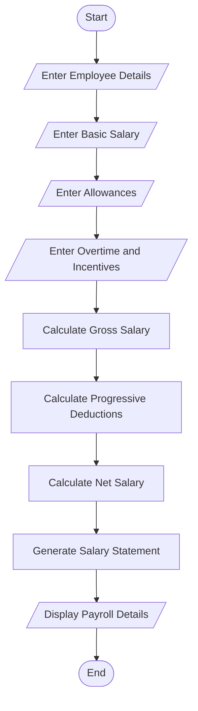

# Employee Payroll and Deduction Analysis

## 1. Problem Statement

Develop a Python program to calculate an employee's salary based on basic pay, allowances, overtime, and incentives. Calculate the gross salary and apply progressive deductions based on the salary amount. Finally, generate a formatted salary statement showing the employee details, gross salary, total deductions, and net salary.

## 2. Algorithm

1. Start the program.
2. Enter employee name and employee ID.
3. Read basic salary.
4. Read allowances.
5. Read overtime amount.
6. Read incentives.
7. Calculate gross salary.

&#x20;  Gross Salary = Basic Pay + Allowances + Overtime + Incentives

8. Calculate progressive deductions:
   - If gross salary is up to ₹20,000, deduction = 5%.
   - If gross salary is up to ₹40,000, deduction = 10%.
   - If gross salary is above ₹40,000, deduction = 15%.
9. Calculate net salary.

&#x20;  Net Salary = Gross Salary − Total Deductions

10. Display the salary statement.
11. Stop.

For this example, the deduction rate is applied to the entire gross salary based on its slab.

## 3. Flowchart (Mermaid)


## 4. Python Source Code

```
# Employee Payroll and Deduction Analysis# Get employee detailsname = input("Enter Employee Name: ")emp_id = input("Enter Employee ID: ")# Get salary detailsbasic = float(input("Enter Basic Pay: "))allowances = float(input("Enter Allowances: "))overtime = float(input("Enter Overtime: "))incentives = float(input("Enter Incentives: "))# Calculate Gross Salarygross = basic + allowances + overtime + incentives# Calculate Progressive Deductionif gross <= 20000:    deduction_rate = 0.05elif gross <= 40000:    deduction_rate = 0.10else:    deduction_rate = 0.15deduction = gross * deduction_rate# Calculate Net Salarynet_salary = gross - deduction# Display Salary Statementprint("\n===== EMPLOYEE SALARY STATEMENT =====")print("Employee Name :", name)print("Employee ID   :", emp_id)print("Basic Pay     :", basic)print("Allowances    :", allowances)print("Overtime      :", overtime)
```

## 5. Sample Input

```
Enter Employee Name: Ramesh
Enter Employee ID: 101
Enter Basic Pay: 25000
Enter Allowances: 5000
Enter Overtime: 2000
Enter Incentives: 3000
```

## 6. Sample Output

```
===== EMPLOYEE SALARY STATEMENT =====

Employee Name : Ramesh
Employee ID   : 101
Basic Pay     : 25000
Allowances    : 5000
Overtime      : 2000
Incentives    : 3000
------------------------------------
Gross Salary  : 35000.0
Deduction     : 3500.0
Net Salary    : 31500.0
====================================
```

## 7. Result

Thus, the Python program for Employee Payroll and Deduction Analysis was successfully developed and executed. It calculates gross salary, applies the appropriate deduction rate, and displays the employee's final net salary in a formatted salary statement.
