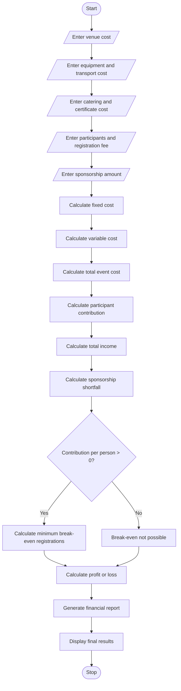

# Campus Event Financial Planning – Python Program

## 1. Problem Statement

Develop a Python program for Campus Event Financial Planning to calculate the total expenses required to organize a college event.

The program should consider venue charges, equipment costs, catering expenses, transportation charges, and certificate costs.

It should also calculate participant contributions, sponsorship amounts, sponsorship shortfalls, and the minimum number of registrations required to break even.

The program should generate a final financial report showing total expenses, income, and profit or loss.

## 2. Algorithm

1. Start the program.
2. Enter the venue cost.
3. Enter the equipment cost.
4. Enter the catering cost per participant.
5. Enter the transportation cost.
6. Enter the certificate cost per participant.
7. Enter the expected number of participants.
8. Enter the registration fee per participant.
9. Enter the sponsorship amount.
10. Calculate the total fixed cost.
11. Calculate the variable cost per participant.
12. Calculate the total event cost.
13. Calculate the participant contribution.
14. Calculate the total available income.
15. Calculate the sponsorship shortfall, if any.
16. Calculate the minimum registrations required to break even.
17. Display the final financial report.
18. Stop the program.

## 6. Flowchart (Mermaid)

## 4. Sample Input

```
Enter venue cost: 10000
Enter equipment cost: 5000
Enter transportation cost: 3000
Enter catering cost per participant: 200
Enter certificate cost per participant: 50
Enter expected number of participants: 100
Enter registration fee per participant: 400
Enter sponsorship amount: 15000
```

## 5. Sample Output

```
===== EVENT FINANCIAL REPORT =====

Fixed Cost: Rs. 18000.0
Variable Cost: Rs. 250.0
Total Variable Cost: Rs. 25000.0
Total Event Cost: Rs. 43000.0

Participant Contribution: Rs. 40000.0
Sponsorship Amount: Rs. 15000.0
Total Income: Rs. 55000.0

Sponsorship Shortfall: Rs. 0

Minimum Registrations Required: 0
Profit / Loss: Rs. 12000.0

Result: Event is in Profit

Financial Planning Completed.
```


