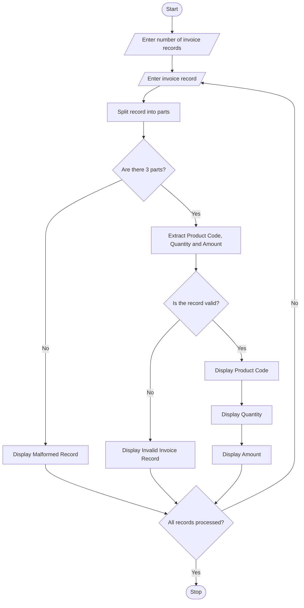

# Text-Based Invoice Data Extraction

## 1. Problem Statement

To develop a Python program that processes formatted invoice strings using basic string operations. The program extracts product codes, quantities, and amounts from each invoice record. It checks whether the records are valid or malformed and displays the extracted invoice details.

## 2. Algorithm

1. Start the program.
2. Read the number of invoice records.
3. Read each invoice record as a string.
4. Split the invoice string using the comma separator.
5. Check whether the record contains exactly three fields.
6. Extract the product code, quantity, and amount.
7. Validate the product code, quantity, and amount.
8. If the record is valid, display the extracted details.
9. If the record is invalid, display "Malformed Record".
10. Repeat until all records are processed.
11. Stop the program.

## 3. Python Source Code


## 4. Sample Input

```
Enter number of invoice records: 4
Enter invoice record: P101,2,500
Enter invoice record: P102,5,1200
Enter invoice record: P103,abc,300
Enter invoice record: P104,3
```

## 5. Sample Output

```
Valid Invoice Record
Product Code: P101
Quantity: 2
Amount: Rs. 500

Valid Invoice Record
Product Code: P102
Quantity: 5
Amount: Rs. 1200

Malformed Record: P103,abc,300

Malformed Record: P104,3
```

## 6. Result

Thus, the Python program successfully extracts product codes, quantities, and amounts from formatted invoice strings and identifies malformed invoice records using basic string operations.
