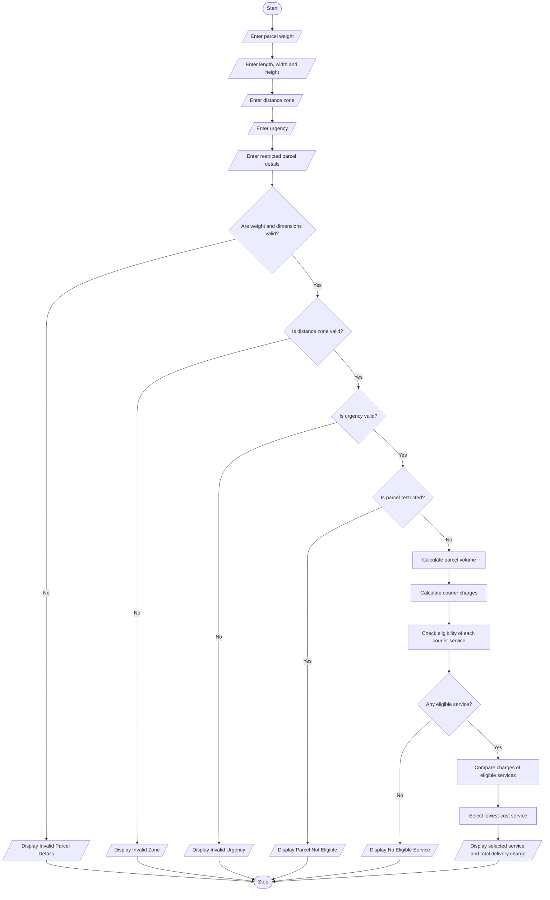

# Courier Charge Optimization

## 1. Problem Statement

The Courier Charge Optimization program calculates delivery charges based on parcel weight, dimensions, distance zones, delivery urgency, and declared restrictions.

The program compares different courier service options such as Standard, Express, and Same-Day delivery. It checks whether the parcel is eligible for each service, calculates the total delivery charge, and selects the most suitable and lowest-cost eligible service.

## 2. Algorithm

1. Start the program.
2. Read parcel weight.
3. Read parcel length, width, and height.
4. Calculate parcel volume.
5. Read the distance zone.
6. Read the delivery urgency.
7. Check whether the parcel has any restricted items.
8. Calculate the courier charges based on:
   - Parcel weight
   - Parcel dimensions
   - Distance zone
   - Delivery urgency
9. Check the eligibility of each courier service.
10. Compare the charges of eligible services.
11. Select the lowest-cost eligible service.
12. Display the selected service and total delivery charge.
13. Stop the program.

## 3. Python Source Code



## 4. Sample Input

```
Enter parcel weight (kg): 2
Enter length (cm): 30
Enter width (cm): 20
Enter height (cm): 10
Enter distance zone (Local/Regional/National): local
Enter urgency (Standard/Express/Same-Day): express
Does parcel contain restricted items? (yes/no): no
```

## 5. Sample Output

```
Courier Service Charges

Standard : 110.0
Express : 150.0

Selected Service: Standard
Total Delivery Charge: Rs. 110.0
```

## 6. Formula Used

Volumetric Weight:

\\[ \frac{Length \times Width \times Height}{5000} \\]

Chargeable Weight:

\\[ \max(\text{Actual Weight},\text{Volumetric Weight}) \\]

Delivery Charge:

\\[ \text{Zone Charge}+ (\text{Chargeable Weight}\times40\times\text{Multiplier}) \\]

Note: These are example courier rates for the programming problem, not actual courier company prices.
