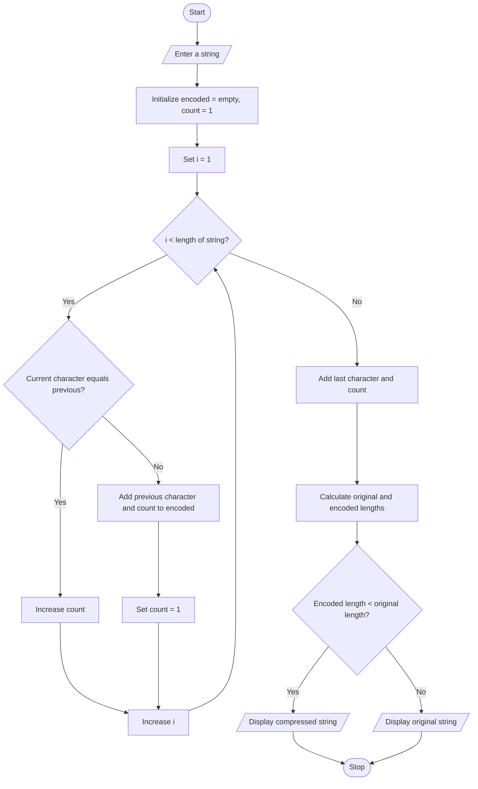

# Text Compression Using Character Runs – Python Program

## 1. Problem Statement

Write a Python program to perform text compression using Run-Length Encoding (RLE).

The program should:

- Read a string from the user.
- Group consecutive repeated characters.
- Encode each group using the character followed by its count.
- Calculate the original and compressed string lengths.
- Compare both lengths.
- If the encoded string is not shorter than the original string, display the original string as the better option.

## 2. Algorithm

1. Start the program.
2. Read a string from the user.
3. Initialize an empty encoded string.
4. Set the count of the first character to 1.
5. Compare each character with the next character.
6. If both characters are the same, increase the count.
7. Otherwise, add the character and its count to the encoded string.
8. Repeat until all characters are processed.
9. Calculate the original and encoded string lengths.
10. Compare both lengths.
11. If encoded length is smaller, display the compressed string.
12. Otherwise, display the original string.
13. Stop the program.

## 6. Flowchart

```
 ## 4. Sample Input

Enter Employee ID: 101
Enter Employee Name: Ravi

Enter Basic Salary: 30000
Enter HRA percentage: 10
Enter DA percentage: 5

Enter Overtime Hours: 10
Enter Overtime Rate per Hour: 200

Enter Incentives: 3000
```
```
## 5. Sample Output
===== EMPLOYEE SALARY STATEMENT =====

Employee ID: 101
Employee Name: Ravi

Basic Salary: Rs. 30000.0
HRA: Rs. 3000.0
DA: Rs. 1500.0
Overtime Payment: Rs. 2000.0
Incentives: Rs. 3000.0

----------------------------------
Gross Salary: Rs. 39500.0
Total Deduction: Rs. 2450.0
```

----------------------------------

Net Salary: Rs. 37050.0

Payroll Calculation Completed.
