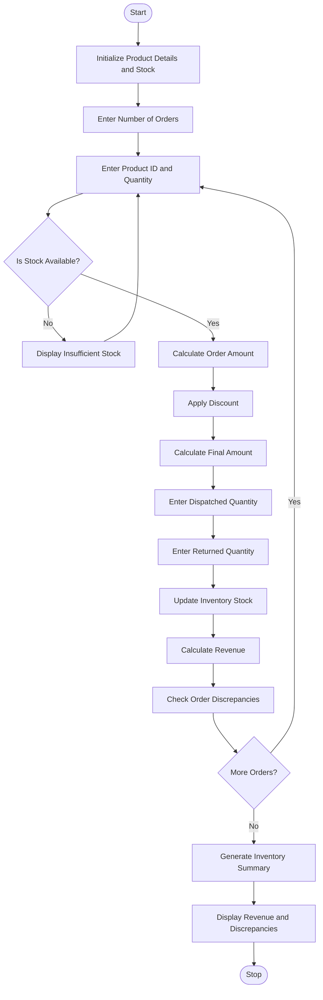

# Integrated E-Commerce Order Processing and Reconciliation

## 1. Problem Statement

Develop a Python program for an Integrated E-Commerce Order Processing and Reconciliation System. The program processes customer product orders, calculates discounts, manages product dispatches and returns, and updates available stock.

It should calculate the total sales revenue, identify discrepancies between ordered, dispatched, and returned quantities, and generate a final inventory summary showing the remaining stock of each product.

## 2. Algorithm

1. Start the program.
2. Initialize product details with product ID, name, price, and available stock.
3. Enter the number of products ordered.
4. Read product ID and order quantity.
5. Check whether sufficient stock is available.
6. Calculate the order amount.
7. Apply the discount based on the order value.
8. Calculate the final amount after discount.
9. Enter dispatched quantity.
10. Enter returned quantity.
11. Update the available stock.
12. Calculate total revenue.
13. Compare ordered and dispatched quantities.
14. Identify any discrepancies.
15. Display the final order details and inventory summary.
16. Stop the program.

## 3. Flowchart




## 5. Sample Input

```
Enter number of orders: 3

Order 1
Enter Product ID: 101
Enter Order Quantity: 2
Enter dispatched quantity: 2
Enter returned quantity: 0

Order 2
Enter Product ID: 102
Enter Order Quantity: 2
Enter dispatched quantity: 2
Enter returned quantity: 1

Order 3
Enter Product ID: 103
Enter Order Quantity: 3
Enter dispatched quantity: 2
Enter returned quantity: 0
```

## 6. Sample Output

```
Order 1
Product: Laptop
Order Amount: Rs. 100000
Discount: Rs. 10000.0
Final Order Amount: Rs. 90000.0
Dispatched: 2
Returned: 0
Sold Quantity: 2
Revenue: Rs. 100000

Order 2
Product: Mobile
Order Amount: Rs. 40000
Discount: Rs. 2000.0
Final Order Amount: Rs. 38000.0
Dispatched: 2
Returned: 1
Return detected: 1
Sold Quantity: 1
Revenue: Rs. 20000

Order 3
Discrepancy: Ordered and dispatched quantities differ
Product: Headphones
Order Amount: Rs. 6000
Discount: Rs. 0
Final Order Amount: Rs. 6000
Dispatched: 2
Returned: 0
Sold Quantity: 2
Revenue: Rs. 4000

----- FINAL SUMMARY -----

Total Processed Orders: 3
Total Revenue: Rs. 121000.0

----- INVENTORY SUMMARY -----

Product ID: 101
Product Name: Laptop
Available Stock: 8

Product ID: 102
Product Name: Mobile
Available Stock: 14

Product ID: 103
Product Name: Headphones
Available Stock: 18

Order Processing Completed.
```


