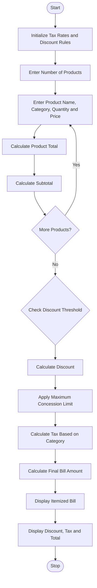

# Retail Billing with Multiple Discount Rules

## 1. Problem Statement

Develop a Python program for a Retail Billing System that processes multiple products and their quantities. The program should calculate product prices, apply category-specific taxes, provide discounts based on purchase amount thresholds, and maintain a maximum concession limit.

Finally, generate an itemized customer bill displaying product names, quantities, prices, discounts, taxes, and the final payable amount.

## 2. Algorithm

1. Start the program.
2. Initialize product details, prices, and tax rates.
3. Enter the number of products.
4. Enter product name, category, quantity, and price.
5. Calculate the total price of each product.
6. Calculate the subtotal of all products.
7. Check the discount eligibility based on purchase amount.
8. Apply the appropriate discount percentage.
9. Check the maximum concession limit.
10. Calculate the final discount.
11. Calculate category-specific taxes.
12. Calculate the final bill amount.
13. Display the itemized bill.
14. Display total discount, tax, and payable amount.
15. Stop the program.

## 3. Flowchart



## 5. Sample Input

```
Enter number of products: 3

Product 1
Enter product name: Rice
Enter category: food
Enter quantity: 2
Enter price: 1000

Product 2
Enter product name: Shirt
Enter category: clothing
Enter quantity: 2
Enter price: 1500

Product 3
Enter product name: Mobile
Enter category: electronics
Enter quantity: 1
Enter price: 5000
```

## 6. Sample Output

```
========== ITEMIZED BILL ==========

Product: Rice
Category: food
Quantity: 2
Unit Price: Rs. 1000.0
Amount: Rs. 2000.0
Discount: Rs. 200.0
Tax: Rs. 90.0

Product: Shirt
Category: clothing
Quantity: 2
Unit Price: Rs. 1500.0
Amount: Rs. 3000.0
Discount: Rs. 300.0
Tax: Rs. 324.0

Product: Mobile
Category: electronics
Quantity: 1
Unit Price: Rs. 5000.0
Amount: Rs. 5000.0
Discount: Rs. 500.0
Tax: Rs. 810.0

========== FINAL BILL ==========

Subtotal: Rs. 10000.0
Discount: Rs. 1000.0
Total Tax: Rs. 1224.0
Maximum Discount Limit: Rs. 2000
Final Payable Amount: Rs. 10224.0

Thank you for shopping!
```

