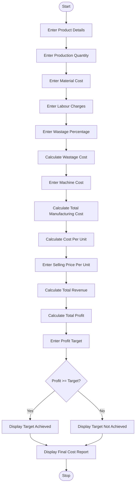

# Manufacturing Cost and Profitability Analysis

## 1. Problem Statement

Develop a Python program for a Manufacturing Cost and Profitability Analysis System. The program calculates the total manufacturing cost by considering raw material costs, labour charges, material wastage, and machine operating costs.

The program should calculate the total production cost, cost per unit, selling price, total revenue, and profit. It should also compare the actual profit with a specified profit target and identify whether the production meets the required target.

## 2. Algorithm

1. Start the program.
2. Enter the product name.
3. Enter the number of units produced.
4. Enter the raw material cost.
5. Enter the labour charges.
6. Enter the material wastage percentage.
7. Calculate the wastage cost.
8. Enter the machine operating cost.
9. Calculate the total manufacturing cost.
10. Calculate the manufacturing cost per unit.
11. Enter the selling price per unit.
12. Calculate total sales revenue.
13. Calculate total profit.
14. Enter the required profit target.
15. Compare actual profit with the target.
16. Display whether the profit target is achieved or not.
17. Display the complete manufacturing cost report.
18. Stop the program.

## 3. Flowchart

## 5. Sample Input

```
Enter product name: Chairs
Enter production quantity: 100
Enter raw material cost: 50000
Enter labour charges: 15000
Enter wastage percentage: 10
Enter machine operating cost: 10000
Enter selling price per unit: 1000
Enter profit target: 15000
```

## 6. Sample Output

```
===== MANUFACTURING REPORT =====

Product Name: Chairs
Production Quantity: 100

Material Cost: Rs. 50000.0
Labour Cost: Rs. 15000.0
Wastage Cost: Rs. 5000.0
Machine Cost: Rs. 10000.0

Total Manufacturing Cost: Rs. 80000.0

Cost Per Unit: Rs. 800.0

Selling Price Per Unit: Rs. 1000.0

Total Revenue: Rs. 100000.0

Total Profit: Rs. 20000.0

Profit Percentage: 25.0 %

Result: Profit Target Achieved

Analysis Completed.
```

