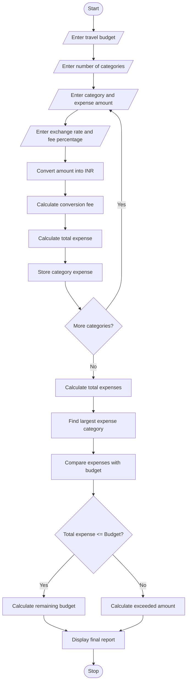

# Multi-Currency Travel Budget Analysis – Python Program

## 1. Problem Statement

Develop a Python program for Multi-Currency Travel Budget Analysis to calculate travel expenses in different currencies.

The program should accept travel expenses in foreign currencies, convert them into the home currency using supplied exchange rates, and include currency conversion fees.

The system should:

1. Accept different travel expense categories such as food, hotel, transport, and shopping.
2. Enter expense amounts in different currencies.
3. Convert foreign currency amounts into Indian Rupees (INR).
4. Calculate currency conversion fees.
5. Calculate total travel expenses.
6. Compare total expenses with the planned budget.
7. Identify whether the traveler is within or above the budget.
8. Identify the largest expense category.
9. Generate a final travel budget report.

## 2. Algorithm

1. Start the program.
2. Enter the total travel budget in INR.
3. Enter the number of expense categories.
4. Enter the expense category name.
5. Enter the expense amount.
6. Enter the currency exchange rate.
7. Enter the currency conversion fee percentage.
8. Convert the foreign currency amount into INR.
9. Calculate the conversion fee.
10. Calculate the total expense including fees.
11. Repeat the process for all expense categories.
12. Calculate the total travel expenses.
13. Compare total expenses with the planned budget.
14. Identify the largest expense category.
15. Calculate the remaining budget or extra amount spent.
16. Display the final travel budget report.
17. Stop the program.

## 6. Flowchart (Mermaid)



## 4. Sample Input

```
Enter total travel budget in INR: 100000

Enter number of expense categories: 4

Expense Category 1
Enter category name: Hotel
Enter expense amount: 200
Enter exchange rate to INR: 90
Enter conversion fee percentage: 2

Expense Category 2
Enter category name: Food
Enter expense amount: 100
Enter exchange rate to INR: 90
Enter conversion fee percentage: 2

Expense Category 3
Enter category name: Transport
Enter expense amount: 150
Enter exchange rate to INR: 90
Enter conversion fee percentage: 2

Expense Category 4
Enter category name: Shopping
Enter expense amount: 300
Enter exchange rate to INR: 90
Enter conversion fee percentage: 2
```

## 5. Sample Output

```
===== FINAL TRAVEL EXPENSE REPORT =====

Category: Hotel
Original Amount: 200.0
Converted Amount: Rs. 18000.0
Conversion Fee: Rs. 360.0
Total Expense: Rs. 18360.0

Category: Food
Original Amount: 100.0
Converted Amount: Rs. 9000.0
Conversion Fee: Rs. 180.0
Total Expense: Rs. 9180.0

Category: Transport
Original Amount: 150.0
Converted Amount: Rs. 13500.0
Conversion Fee: Rs. 270.0
Total Expense: Rs. 13770.0

Category: Shopping
Original Amount: 300.0
Converted Amount: Rs. 27000.0
Conversion Fee: Rs. 540.0
Total Expense: Rs. 27540.0

Total Travel Expense: Rs. 68850.0

Planned Budget: Rs. 100000.0

Largest Expense Category: Shopping

Remaining Budget: Rs. 31150.0

Status: Within Budget

Travel Budget Analysis Completed.
```


