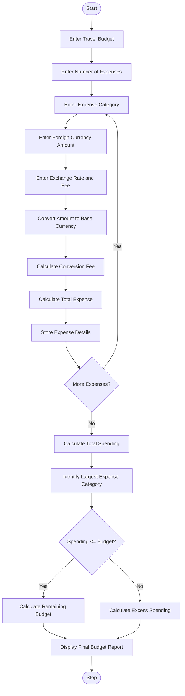

# 9. Multi-Currency Travel Budget Analysis

## 1. Problem Statement

Develop a Python program for a Multi-Currency Travel Budget Analysis System. The program converts travel expenses from different currencies into a common base currency using supplied exchange rates.

The program should include currency conversion fees, calculate total travel expenses, compare planned spending against the available budget, and identify the largest expense category.

Finally, generate a travel budget report displaying converted expenses, conversion fees, total spending, remaining budget, and the largest expense category.

## 2. Algorithm

1. Start the program.
2. Enter the travel budget in the base currency.
3. Enter the number of expense categories.
4. Enter the expense category name.
5. Enter the expense amount in foreign currency.
6. Enter the currency exchange rate.
7. Enter the currency conversion fee percentage.
8. Convert the foreign currency amount into the base currency.
9. Calculate the conversion fee.
10. Calculate the total expense including the fee.
11. Repeat the process for all expense categories.
12. Calculate the total travel expenses.
13. Identify the largest expense category.
14. Compare total expenses with the available budget.
15. Calculate the remaining budget or excess spending.
16. Display the final travel budget report.
17. Stop the program.

## 3. Flowchart


5.SAMPLE INPUT

```
Enter travel budget (INR): 100000
Enter number of expense categories: 3

Expense 1
Enter expense category: Hotel
Enter foreign currency amount: 200
Enter exchange rate (INR): 85
Enter conversion fee percentage: 2

Expense 2
Enter expense category: Food
Enter foreign currency amount: 100
Enter exchange rate (INR): 85
Enter conversion fee percentage: 1

Expense 3
Enter expense category: Shopping
Enter foreign currency amount: 300
Enter exchange rate (INR): 85
Enter conversion fee percentage: 2
```

6.SAMPLE OUTPUT

```
========== TRAVEL EXPENSE REPORT ==========

Category: Hotel
Converted Amount: Rs. 17000.0
Conversion Fee: Rs. 340.0
Total Expense: Rs. 17340.0

Category: Food
Converted Amount: Rs. 8500.0
Conversion Fee: Rs. 85.0
Total Expense: Rs. 8585.0

Category: Shopping
Converted Amount: Rs. 25500.0
Conversion Fee: Rs. 510.0
Total Expense: Rs. 26010.0

========== FINAL BUDGET SUMMARY ==========

Travel Budget: Rs. 100000.0
Total Spending: Rs. 51935.0

Remaining Budget: Rs. 48065.0
Status: Within Budget

Largest Expense Category: Shopping
Largest Expense Amount: Rs. 26010.0

Travel Budget Analysis Completed.
```
